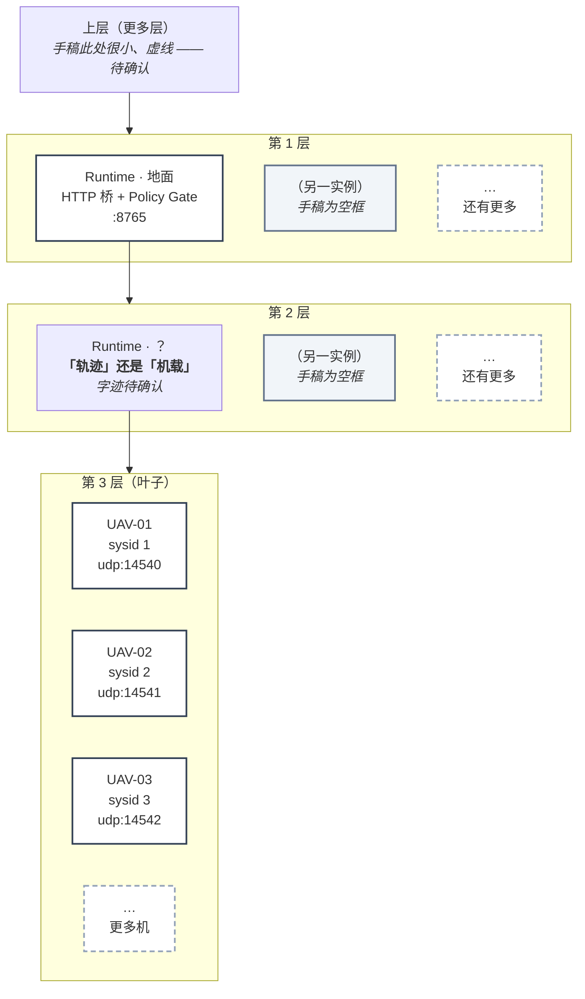

# 分层堆叠架构（按手绘稿重绘）

**来源**：手绘稿（2026-10-19 23:22 拍摄）+ 仓库实测。
**图片**：`architecture-stack.svg`（矢量，可缩放）/ `architecture-stack.png`（位图，便于粘贴）

---

## 拓扑

手稿不是"简单堆叠"，是**三层 fan-out 树**：每层一条横向总线，挂若干子节点，
**其中最左边的子节点继续向下延伸**到下一层；虚线框表示"还有更多"。



---

## 每层在真实系统里对应什么（来自代码，不是推测）

| 层 | 手稿写的 | 真实对应 |
| --- | --- | --- |
| **第 3 层 · 叶子** | `UAV-01/02/03` + 虚线 | **三架无人机 = 三条独立 MAVLink 长期会话**。每机有独立 `sysid`/`compid`，动作前必须核验（防串号）。端口 `14540/14541/14542`。 |
| **第 2 层 · 待确认** | `Runtime` + 两个字 | **若是「机载」** → Jetson/工控机上的 Runtime，用 ROS 读位姿/雷达/相机（**当前未实现**）。**若是「轨迹」** → 属于规划/航迹层，不是 Runtime 实例，那这层应画成**数据流**而非节点。 |
| **第 1 层 · 地面** | `Runtime` + 「地面」 | **地面 Runtime `:8765`** = Policy Gate + 动作生命周期 + 审计 JSONL + 回放。主控台 `5178` / 三维 `5179` 挂在它上面。 |
| **第 0 层 · 上层** | 一个向上箭头 + 一小组虚线 | 手稿只画了箭头和虚线 —— 按"更多层级"理解，可能是云端 / 指挥所 / 多车协同。**待确认**。 |

---

## ⚠️ 三个必须说清的点

### 1. 手稿画的是**两层 Runtime**，当前实现只有**一层**

```
手稿:          地面 Runtime  →  中间层 Runtime  →  各机
当前实现:      地面 Runtime  ────────────────→  各机（长会话）
```

**仓库里没有任何"机载 Runtime"代码。** 现在的 `Runtime` 是单一进程，
通过多条 MAVLink 会话同时管三架机（`mavlink_backend_session.py` 2067 行）。

所以这张图如果当作"现状"会误导，**应该读成"目标形态"**。

### 2. 虚线框不能照搬 —— 当前只支持 3 机

`three_uav_sitl.json` / `three_uav_mono_cam_sitl.json` 里写死了三架。
**扩展机数需要改 manifest**，不是自动的。手稿的"更多机"是意图，不是现状。

### 3. 第 2 层那两个字是关键分歧

* **「机载」** → 我们现在的做法（地面 Runtime + MAVLink 直连飞控）**需要改架构**：
  要新增一个跑在 Jetson/工控机上的 Runtime，用 ROS 读机载传感器。
* **「轨迹」** → 那它属于规划/航迹层，**Runtime 的现有分层不用动**，只是多一个数据源。

**这两个结论完全相反，所以必须先确认。**

---

## 与手绘稿的对应关系

| 手稿元素 | 本图处理 |
| --- | --- |
| 每层一条横线（总线） | 保留为横向总线 |
| 最左子节点继续下延 | 保留（`R1 → R2 → UAVs`） |
| 虚线框 | 保留为虚线（"还有更多"） |
| 空框 | 保留为浅灰框，标"手稿为空框" |
| 顶部小虚线 + 上箭头 | 保留为"上层（更多层）"，标"待确认" |
| 手写字迹不清处 | **用橙色标出，不猜** |

---

## 待确认（会改变架构结论）

- [ ] 第 2 层的两个字是 **「机载」** 还是 **「轨迹」**？
- [ ] 第 0 层那个小虚线框是什么（云端？指挥所？多集群）？
- [ ] 每层的"另一实例"是**冗余备份**还是**并行多实例**？
- [ ] 目标形态是**两层 Runtime**，还是这张图只是**逻辑分层**（物理上仍是一个进程）？

---

## 重绘方式

```bash
# 编辑 SVG 后重新渲染 PNG（Windows，用 Edge 无头模式）
msedge --headless --disable-gpu --hide-scrollbars \
       --force-device-scale-factor=1.5 --window-size=1080,1320 \
       --screenshot=architecture-stack.png architecture-stack.svg
```

SVG 是**纯文本**，可以直接改文字/坐标；PNG 只是渲染产物，不用手工编辑。
